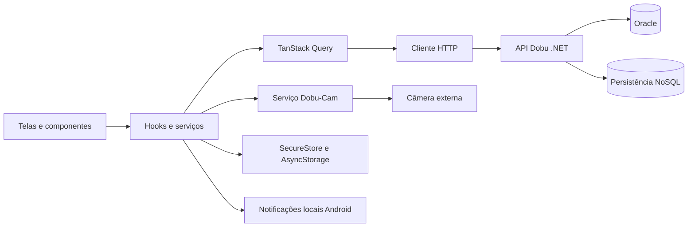

# Dobu Mobile

**Cuidado que acompanha.**

O Dobu aproxima tutores e veterinários no cuidado diário dos animais. O aplicativo reúne consultas, vacinas e anotações do animal e oferece acompanhamento por câmera externa para os momentos em que o tutor está longe.

Este repositório contém o aplicativo mobile da Sprint 4, desenvolvido em React Native com Expo. A [API .NET](https://github.com/DobuChallenge/Dobu-Sprint4.NET) e a [Dobu-Cam](https://github.com/DobuChallenge/Dobu-Cam) são serviços separados que se integram ao aplicativo.

## Conheça o aplicativo

O responsável cadastra seus animais, consulta o caderno de cuidados e organiza os próximos atendimentos. O veterinário acompanha os animais atendidos, registra observações e conversa com o tutor para combinar a consulta. Os registros ficam vinculados ao animal, permitindo que o tutor consulte as anotações do atendimento depois.

| Área | Recursos |
| --- | --- |
| Conta | Cadastro de responsável ou veterinário, login, edição de perfil, foto e restauração da sessão |
| Animais | Cadastro, consulta, edição e exclusão, com espécie, raça e responsável |
| Agendamentos | Cadastro, consulta, edição, cancelamento e exclusão de consultas |
| Conversa da consulta | Mensagens e confirmação do horário pelos dois participantes |
| Caderno de cuidados | Anotações por animal, registro de vacinas e próxima dose |
| Informações | Pesquisa de raças e conteúdos sobre animais em fontes públicas |
| Dobu-Cams | Cadastro por animal, nome da câmera, conexão externa e marcação dos potes no quadro |
| Lembretes | Notificações locais no horário das consultas futuras |
| Aparência | Temas claro e escuro, preferência salva e opção de seguir o sistema |
| Sobre | Versão instalada e commit de referência do APK |

Os CRUDs de animais e agendamentos das entregas anteriores foram preservados. O caderno de cuidados ficou separado da pesquisa de informações. As fotos dos perfis são armazenadas no aparelho; os demais registros dessa tabela utilizam a API quando há persistência no servidor.

## Instalação no Android

A distribuição é feita pelo **Firebase App Distribution**, para as contas convidadas:

[Instalar o Dobu](https://appdistribution.firebase.google.com/testerapps/1:919066649336:android:d241bf696efeb54462d10d/releases/0lf1gkucvlbng)

Abra o link usando a mesma conta Google que recebeu o convite. O Firebase apresenta a versão disponível e as instruções de instalação. O aplicativo Android utiliza o identificador `com.dobuchallenge.mobile`.

A versão publicada é a **1.0.5 (9)**, com convite de instalação enviado ao professor. O [código desse APK](https://github.com/DobuChallenge/Dobu-FinalSprint4/tree/a9d2909ed35c8c25373762fb7c48e797bb9ff04f) corresponde ao commit `a9d2909ed35c8c25373762fb7c48e797bb9ff04f`. A tela **Perfil → Sobre o Dobu** informa a versão e o hash completo do código usado na compilação. Essa referência identifica o código do APK, mesmo quando o README recebe atualizações posteriores.

A API para esta versão está disponível em HTTPS:

```text
https://dobu-sprint4-api-rm563549.azurewebsites.net
```

A API utiliza o Oracle da faculdade. A persistência de observações da câmera utiliza uma conta Azure Cosmos DB com API compatível com MongoDB. Os serviços de banco são acessados pelo servidor; suas credenciais não fazem parte do aplicativo. A hospedagem usa a camada gratuita do App Service, sujeita a limites de uso e inicialização após períodos de inatividade.

A instalação pelo Firebase e o funcionamento da API não exigem estar na rede Wi-Fi da equipe. A transmissão da câmera tem configuração própria, descrita abaixo.

## Dobu-Cam

Em **Dobu-Cams**, selecione o animal e cadastre uma câmera com um nome, como Sala. Abra a câmera cadastrada para acessar o monitor. O aplicativo oferece somente **câmera externa**.

Há dois endereços nessa configuração:

- **Endereço da Dobu-Cam:** o computador ou servidor que executa o serviço Python, por exemplo `http://192.168.15.10:5000`;
- **IP ou endereço da câmera externa:** a transmissão do celular ou da câmera IP, por exemplo `http://192.168.15.5:8080/video`.

Abra a transmissão no aplicativo de câmera do celular e informe os endereços no Dobu. Toque em **Ligar câmera externa**. O serviço Python precisa conseguir acessar a transmissão e o aparelho com o Dobu precisa conseguir acessar esse serviço. Em um teste local, mantenha os dispositivos na mesma rede.

O quadro no topo da tela permanece visível durante a sincronização. Quando houver uma imagem disponível, ela aparece nesse mesmo espaço. **Atualizar imagem** solicita uma nova tentativa; o aplicativo não apresenta uma imagem antiga como câmera conectada. O endereço informado fica salvo no aparelho, separado por conta e câmera.

Com a imagem carregada, marque as áreas dos potes de comida e água e salve as marcações. A análise observa a permanência de um cão ou gato identificado dentro da região marcada por pelo menos quatro segundos. Uma visita contínua conta uma vez e água e comida têm contadores separados. Sem marcação ou sem uma identificação recente do animal, nenhum evento de alimentação ou hidratação é contado.

Os eventos indicam **possível alimentação ou hidratação**. A proximidade do pote não comprova consumo. A pouca atividade por uma hora pode indicar possível descanso; a câmera não diagnostica doenças e não substitui avaliação veterinária. Não há eventos pré-gravados nem vídeo de exemplo nesta versão.

O serviço atual processa uma fonte de captura por vez. Cadastrar várias câmeras organiza os acessos, mas não cria transmissões simultâneas. O APK não inclui o servidor Python nem torna um IP privado acessível pela internet: para acompanhar fora da rede da câmera, o serviço precisa ser publicado em um endereço acessível e protegido.

## Notificações das consultas

O Dobu usa **notificações locais do Android**, vinculadas a agendamentos reais. Em **Lembretes**, ative os alertas e conceda a permissão solicitada pelo sistema. Uma consulta futura com status Agendado ou Confirmado gera um lembrete para o horário cadastrado. O aviso identifica o animal e, ao ser tocado, abre o agendamento correspondente na conta autenticada.

A tela mostra quantos lembretes estão programados e qual é o próximo horário. Ao editar ou cancelar uma consulta, o aplicativo ajusta os lembretes durante a próxima sincronização da agenda. Essa consulta ocorre a cada 30 segundos enquanto o app está ativo e quando ele volta ao primeiro plano. Ao sair da conta, os lembretes daquela sessão são removidos.

O sistema operacional entrega os avisos já programados mesmo com o aplicativo em segundo plano. Alterações feitas por outra pessoa enquanto ele está fechado só chegam ao aparelho ao reabrir o app. Não há push remoto nesta versão.

Para verificar o fluxo, cadastre uma consulta para alguns minutos depois, confira o próximo lembrete e deixe o aplicativo em segundo plano. Aguarde o aviso automático e toque nele para retornar à consulta. A prévia web não entrega notificações nativas; essa verificação deve ser feita no APK instalado.

## Arquitetura

A interface foi separada das regras e da comunicação HTTP. As telas recebem o estado e as ações dos hooks, enquanto os serviços concentram validação, filtros e opções das consultas do TanStack Query. As chamadas HTTP ficam em `src/api`.



| Diretório | Responsabilidade |
| --- | --- |
| `src/screens` | Telas e composição da interface |
| `src/components` | Componentes reutilizáveis, campos, cartões e quadro da câmera |
| `src/hooks` | Estado dos formulários, carregamento e ações usadas pelas telas |
| `src/services` | Regras, validações, consultas e planejamento dos lembretes |
| `src/api` | Endpoints, cliente HTTP, autenticação das requisições e erros |
| `src/auth`, `src/storage` e `src/providers` | Sessão, preferências e estado compartilhado |
| `src/navigation` e `src/styles` | Navegação, tema e estilos |
| `tests` | Testes automatizados de regras e integrações |
| `plugins` | Configuração nativa de rede local |

A sessão usa SecureStore no Android e armazenamento local na prévia web. Senhas não são persistidas no aparelho. Preferências de tema, fotos locais e endereços de câmera são mantidos por conta. O cliente HTTP trata erros e timeouts sem apresentar o conteúdo interno das respostas do servidor.

## Executar o projeto

É necessário Node.js 22.7 ou superior, npm e, para o emulador, Android Studio com um dispositivo virtual configurado.

```powershell
git clone https://github.com/DobuChallenge/Dobu-FinalSprint4.git
cd Dobu-FinalSprint4
npm ci
Copy-Item .env.example .env.local
npx expo start
```

A API HTTPS é o endereço padrão. Para usar serviços próprios, configure `.env.local`:

```dotenv
EXPO_PUBLIC_API_URL=https://dobu-sprint4-api-rm563549.azurewebsites.net
EXPO_PUBLIC_CAMERA_API_URL=
```

O endereço da Dobu-Cam também pode ser informado na própria tela da câmera. Variáveis `EXPO_PUBLIC_` entram no aplicativo e devem conter apenas configurações públicas, nunca credenciais.

No terminal do Expo, pressione `a` para abrir no emulador Android ou `w` para a prévia web. Também é possível iniciar diretamente com `npm run android` ou `npm run web`. Se a API estiver no computador local, use `http://10.0.2.2:5100` no emulador; em um celular físico, use o IPv4 desse computador.

As instruções de instalação dos serviços e configuração do Oracle, MongoDB e JWT estão no [repositório da API](https://github.com/DobuChallenge/Dobu-Sprint4.NET). O serviço de câmera é iniciado com `python backend.py` na [Dobu-Cam](https://github.com/DobuChallenge/Dobu-Cam), após instalar suas dependências.

## Testes e compilação

```powershell
npm test
npm run export:android
npm run export:ios
```

A suíte verifica autenticação e sessão, validação dos formulários, isolamento de cache entre contas, vacinas, marcações da câmera, leitura sem imagem recente e sincronização dos lembretes. Também compila as telas para verificar a separação das regras da interface.

Os testes de integração utilizam uma API real, criam registros temporários e removem os dados ao terminar:

```powershell
$env:EXPO_PUBLIC_API_URL = 'https://dobu-sprint4-api-rm563549.azurewebsites.net'
npm run test:integration
```

Esse fluxo cobre cadastro, login, sessão, animais, agenda, caderno, vacinas, cadastro de câmera e conversa. Na revisão desta versão, passaram 60 testes automatizados, os dois testes de integração contra a API HTTPS pública e a verificação de inclusão, consulta ordenada e exclusão de observações NoSQL. A assinatura e o commit do APK foram conferidos, e o arquivo foi instalado e iniciado no emulador Android. O recebimento e o toque na notificação ainda dependem de validação no aplicativo instalado, assim como a transmissão de uma câmera externa real. A exportação verifica os bundles Android e iOS; ela não produz um APK nem substitui os testes de interface em aparelho.

Para gerar outro APK, configure os endereços do ambiente, faça commit do código e execute `npx eas-cli build --platform android --profile preview`, após vincular o projeto à conta Expo. O perfil está em `eas.json`. A versão e o `versionCode` ficam em `app.json`; `app.config.js` inclui o commit da compilação na tela Sobre.

O script `npm run distribuir -- caminho/do/app.apk HASH` permite distribuir uma versão pelo Firebase CLI com `FIREBASE_APP_ID`, `PROFESSOR_EMAIL` e `FIREBASE_CLI_PATH` configurados no ambiente. O repositório deve estar limpo e o hash deve corresponder ao código do APK.

## Demonstração e referências

O vídeo final da Sprint 4 ainda não tem um link publicado neste repositório. O [vídeo da Sprint 3](https://youtu.be/YcE1WVLbJDI) permanece como registro da versão anterior.

- [Protótipo no Figma](https://www.figma.com/design/mOXmQd2t8nKM3tjBE9g5Dn/Challenge)
- [API Dobu — Sprint 4](https://github.com/DobuChallenge/Dobu-Sprint4.NET)
- [Serviço Dobu-Cam](https://github.com/DobuChallenge/Dobu-Cam)
- [Swagger da API publicada](https://dobu-sprint4-api-rm563549.azurewebsites.net/swagger)

## Integrantes

| Nome | RM |
| --- | --- |
| Amandha Yumi Toyota Artulino | 563549 |
| Giovanna Bardella Gomes | 561439 |
| Erick Takeshi Nakajune | 566059 |
